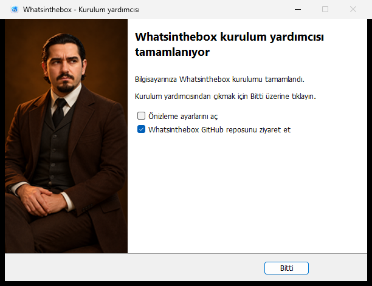

<p align="center"></p>
<p align="center">
 <a href="LICENSE"></a>
 
 <a href="https://github.com/bakhtiyarjahangirzade/Whatsinthebox/actions/workflows/checks.yml"></a>
 <a href="https://github.com/bakhtiyarjahangirzade/Whatsinthebox/releases/tag/v1.0.1"></a>
</p>
<p align="center"><strong>Local file previews, right where your files live.</strong><br>PDFs, artwork, images and fonts. Free and open source.</p>
<p align="center"><a href="https://whatsinthebox-app.vercel.app">Website</a> · <a href="#how-it-works">How it works</a> · <a href="#file-support">File support</a> · <a href="docs/verification.md">Release checks</a> · <a href="CONTRIBUTING.md">Build from source</a></p>

## Release status

**[Download Whatsinthebox 1.0.1 for Windows x64 →](https://github.com/bakhtiyarjahangirzade/Whatsinthebox/releases/download/v1.0.1/Whatsinthebox-1.0.1-Setup.exe)**

One installer, five languages, no separate runtime installation and no administrator requirement. Existing installations offer update or repair; removal restores the handlers that were replaced. The installer is unsigned, so Windows may show a publisher warning. [Verification and checksums →](https://github.com/bakhtiyarjahangirzade/Whatsinthebox/releases/tag/v1.0.1)

## How it works

Select a file in Explorer and press **Alt+P** to open the preview pane. Folder views show real thumbnails instead of generic icons. Nothing else to open, configure or repair.

Whatsinthebox fills the gaps Windows leaves. Formats that Windows (or another program you installed) already previews stay with that handler; JPEG, PNG and the other common image types keep their built-in Windows preview.

Images keep their original proportions and fill the available space: thumbnails along the longer side, the preview pane fitted and centred, re-fitted instantly when the pane is resized.

From version 1.1 the previews are drawn by a small native component that Windows loads in its own isolated preview and thumbnail hosts, the standard model for Explorer extensions. Nothing runs in the background or at sign-in, and no helper program starts per file.

### Before → After

The same Azerbaijan Airlines SVG logo, without a working preview handler and with Whatsinthebox:

| Before | After · Whatsinthebox |
|:---:|:---:|
|  |  |
| A filename, no view inside. | See the artwork, with its original proportions. |

The before panel is an illustration; the after image was rendered by Whatsinthebox from the supplied SVG. The logo belongs to its respective owner and is used only to illustrate file previews; no affiliation is implied.

## File support

| Files | Thumbnail and preview |
|---|---|
| PSD / PSB | Saved composite image (RGB, CMYK, grayscale, indexed; 8, 16 and 32-bit) |
| SVG / SVGZ | Vector artwork drawn by Direct2D, sharp at any size |
| PDF, PDF-compatible AI | First page, drawn by the PDF renderer built into Windows |
| CDR | Embedded page preview (ZIP-based and older RIFF files) |
| ORA, KRA | Merged image saved by OpenRaster and Krita |
| QOI, TGA, PPM / PGM / PBM / PNM | Full decoding |
| TTF / OTF | Font specimen in the preview pane (Windows draws font thumbnails itself) |

If a format already has a working handler on your PC, for example the Microsoft Edge PDF preview, Whatsinthebox leaves it in place and only adds what is missing. Password-protected or damaged files, PSD files saved without a composite image and CDR files without an embedded preview cannot be shown. Previewing never edits your files.

## Installation that understands an existing version

The five-language wizard detects the local version before changing files:

| Local installation | Offered action |
|---|---|
| None | Install |
| Older | Update, or repair and update |
| Same | Repair |
| Newer | Refuse downgrade |

Updates preserve settings. A disabled Windows integration stays deselected. Fresh version folders avoid overwriting files Explorer still has loaded. Setup enables the Windows preview and thumbnail preferences, takes over only formats without a working handler, and refreshes thumbnails Windows had already cached for them in common folders. Updating from 1.0 retires its background helper. Removal restores the previous handlers and preferences. Setup does not close Explorer or restart Windows.

<p align="center"></p>

The classic wizard uses the author portrait and an optional, initially checked link to this repository. Silent setup does not open a browser. The screenshot is from the five-language 1.0 installer verification.

## Privacy and safety

- Rendering stays on your computer. No document uploads, accounts, advertising or telemetry.
- Windows runs the previews in its own isolated hosts: Preview Host at low integrity and the thumbnail surrogate. Explorer itself does not load Whatsinthebox.
- Decoders check every size and offset in the file, reduce large images while reading them and reject oversized input. This is careful code, not a guarantee; no scan proves the absence of vulnerabilities.
- Update checks read public GitHub release metadata; updates are not installed automatically.
- Windows may block downloaded files from the preview pane. A per-file permission action asks for consent before removing the selected PDF's download mark; nothing is unblocked automatically.
- The integration is installed per user, without administrator rights. On accounts that run Explorer elevated (User Account Control turned off, or the built-in Administrator account) Windows ignores per-user extensions.

Read the [security policy](SECURITY.md) and [verification report](docs/verification.md).

## Development

```text
src/Native  Explorer thumbnail provider and preview handler (C++)
src/        Settings application, installer integration and shared UI
tests/      Geometry and Windows integration checks
installer/  Inno Setup wizard and lifecycle helper
scripts/    Build and verification commands
website/    Static Vercel website
docs/       Design, dependencies and release verification
```

Open `Whatsinthebox.slnx` with .NET 10 on Windows, or follow [CONTRIBUTING.md](CONTRIBUTING.md). Build outputs stay in ignored `artifacts/`.

## License

[MIT](LICENSE). One license document includes English, Russian, German, Chinese and Turkish information. Third-party license and copyright texts are retained in [NOTICE.txt](NOTICE.txt). See [dependency details](docs/dependencies.md).

Designed, developed and maintained by [Bakhtiyar Jahangirzade](https://github.com/bakhtiyarjahangirzade). Free for everyone.
